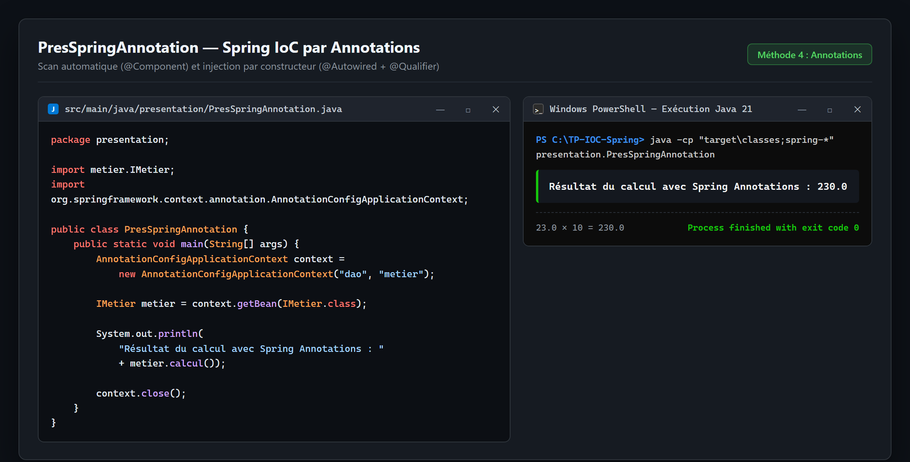

<div align="center">

# TP-IOC-Spring — Inversion de Contrôle & Injection de Dépendances

[](https://adoptium.net/)
[](https://spring.io/)
[](https://maven.apache.org/)
[]()

**Sujet :** Application Java **fermée à la modification et ouverte à l'extension** — Couplage faible & Injection des dépendances (Statique, Dynamique par réflexion, Spring XML, Spring Annotations).

</div>

---

## 📑 Sommaire

1. [Objectif](#-1-objectif)
2. [Architecture du projet](#-2-architecture-du-projet)
3. [Structure des fichiers](#-3-structure-des-fichiers)
4. [Réalisation étape par étape](#-4-réalisation-étape-par-étape)
   - [Couches DAO, Extension (`ext`) & Métier](#couches-dao-extension--métier)
   - [a) Injection par instanciation statique (`Pres1`)](#a-par-instanciation-statique-pres1)
   - [b) Injection par instanciation dynamique (`Pres2`)](#b-par-instanciation-dynamique-pres2)
   - [c) Injection avec Spring XML (`PresSpring`)](#c-avec-spring-xml-presspring)
   - [d) Injection avec Spring Annotations (`PresSpringAnnotation`)](#d-avec-spring-annotations-presspringannotation)
5. [Tableau récapitulatif](#-5-tableau-récapitulatif)
6. [Prérequis & Exécution](#-6-prérequis--exécution)
7. [Conclusion](#-7-conclusion)

---

## 🎯 1. Objectif

Montrer comment créer une application Java **fermée à la modification** et **ouverte à l'extension**, facilitant la maintenance :

1. **Le couplage faible** : dépendre des *interfaces* (`IDao`, `IMetier`) et non des implémentations concrètes.
2. **L'injection des dépendances** : un objet reçoit ses dépendances de l'extérieur (par **constructeur** ou par **setter**) au lieu de les instancier lui-même avec `new`.

Avec l'**Inversion de Contrôle (IoC)**, le développeur écrit le code **métier** ; **Spring** s'occupe de la création et du câblage des objets.

---

## 🏗️ 2. Architecture du projet


---

## 📂 3. Structure des fichiers

```text
TP-IOC-Spring/
├── pom.xml                                  # Maven (Java 21, spring-context 6.2.19)
├── screenshots/                             # Captures Windows (architecture, code & console)
│   ├── 01-architecture-ioc.png
│   ├── 02-couches-dao-metier.png
│   ├── 03-pres1-statique.png
│   ├── 04-pres2-dynamique.png
│   ├── 05-pres3-spring-xml.png
│   └── 06-pres4-spring-annotations.png
└── src/main/
    ├── java/
    │   ├── dao/
    │   │   ├── IDao.java                    # Interface d'accès aux données (getData)
    │   │   └── DaoImpl.java                 # Implémentation BDD (23.0) — @Component("d")
    │   ├── ext/
    │   │   └── DaoImplV2.java               # Extension capteur (12.0) — @Component("d2")
    │   ├── metier/
    │   │   ├── IMetier.java                 # Interface métier (calcul)
    │   │   └── MetierImpl.java              # Calcul (data * 10), constructeur @Autowired + setDao
    │   ├── presentation/
    │   │   ├── Pres1.java                   # Instanciation statique (new)
    │   │   ├── Pres2.java                   # Instanciation dynamique (réflexion + config.txt)
    │   │   ├── PresSpring.java              # Conteneur IoC Spring XML (config.xml)
    │   │   └── PresSpringAnnotation.java    # Conteneur IoC Spring Annotations
    │   └── org/example/
    │       └── Main.java                    # Point d'entrée modèle
    └── resources/
        ├── config.txt                       # Noms des classes pour Pres2
        └── config.xml                       # Déclaration des beans Spring pour PresSpring
```

---

## 🛠️ 4. Réalisation étape par étape

### Couches DAO, Extension & Métier

- **`IDao` / `DaoImpl`** : retourne `23.0` (`@Component("d")`).
- **`ext/DaoImplV2`** : seconde implémentation « capteur » retournant `12.0` (`@Component("d2")`), ajoutée sans modifier `dao` ni `metier`.
- **`IMetier` / `MetierImpl`** : dépend uniquement de `IDao`. Propose un constructeur sans paramètres (pour `Pres1`, `Pres2`, Spring XML) et un constructeur `@Autowired` avec `@Qualifier("d")` (pour Spring Annotations), ainsi que `setDao(IDao dao)`.


---

### a) Par instanciation statique (`Pres1`)

Instanciation directe avec `new DaoImpl()` et `new MetierImpl()`, puis injection via `metier.setDao(dao)`.  
Pour passer à `DaoImplV2`, il faudrait modifier `Pres1.java` et recompiler.


---

### b) Par instanciation dynamique (`Pres2`)

Lecture des classes depuis `src/main/resources/config.txt`, instanciation via `Class.forName(...).getDeclaredConstructor().newInstance()` et injection de `setDao` par réflexion.  
Pour passer à `ext.DaoImplV2`, il suffit de modifier la première ligne de `config.txt` sans toucher au code Java.


---

### c) Avec Spring XML (`PresSpring`)

Le conteneur `ClassPathXmlApplicationContext("config.xml")` instancie les beans `dao` et `metier` et injecte la dépendance via `<property name="dao" ref="dao"/>`.


---

### d) Avec Spring Annotations (`PresSpringAnnotation`)

`AnnotationConfigApplicationContext("dao", "metier")` scanne les packages et injecte automatiquement le bean `@Qualifier("d")` dans le constructeur `@Autowired` de `MetierImpl`.  
Pour basculer vers `DaoImplV2`, il suffit de scanner `"ext"` et d'indiquer `@Qualifier("d2")`.



---

## 📊 5. Tableau récapitulatif

| Technique | Qui crée les objets ? | Basculer vers `DaoImplV2` | Couche présentation fermée à la modification ? |
| :--- | :--- | :--- | :--- |
| **Instanciation statique (`Pres1`)** | Le développeur (`new`) | Modifier le code Java et recompiler | Non |
| **Instanciation dynamique (`Pres2`)** | Le développeur (réflexion) | Modifier `src/main/resources/config.txt` | Oui |
| **Spring XML (`PresSpring`)** | Le conteneur Spring | Modifier `src/main/resources/config.xml` | Oui |
| **Spring Annotations (`PresSpringAnnotation`)** | Le conteneur Spring | Scanner `"ext"` + `@Qualifier("d2")` | Oui |

---

## ⚙️ 6. Prérequis & Exécution

- **JDK 21** (`java -version`)
- **Apache Maven 3.9+** ou **IntelliJ IDEA (Windows)**

```powershell
git clone https://github.com/laqsour/TP-IOC-Spring.git
cd TP-IOC-Spring
mvn compile
```

Exécutez au choix `presentation.Pres1`, `presentation.Pres2`, `presentation.PresSpring` ou `presentation.PresSpringAnnotation`.

---

## 🏁 7. Conclusion

Pour concevoir une application **fermée à la modification et ouverte à l'extension**, il faut combiner le **couplage faible** (interfaces) et l'**injection des dépendances**. En pratique, on privilégie les **annotations Spring** (`@Component`, `@Autowired`, `@Qualifier`) et l'injection par **constructeur**.
