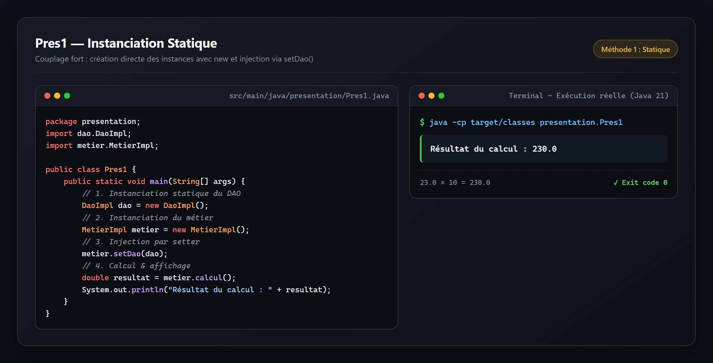
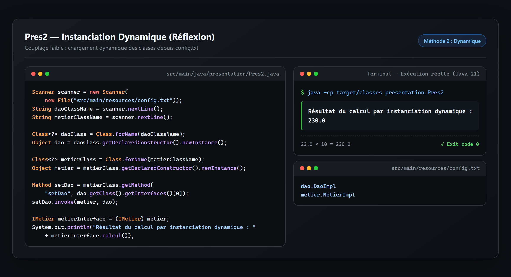
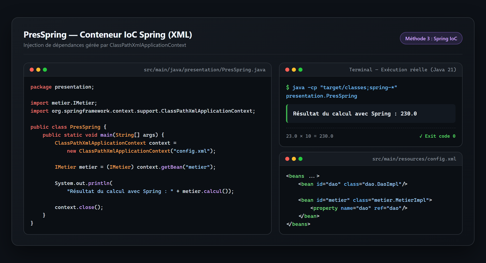

<div align="center">

# TP-IOC-Spring — Inversion de Contrôle & Injection de Dépendances

[](https://adoptium.net/)
[](https://spring.io/)
[](https://maven.apache.org/)

*Projet pédagogique illustrant le principe d'Inversion de Contrôle (IoC) et le passage progressif d'un couplage fort vers un couplage faible avec Java et Spring.*

</div>

---

## Sommaire

- [Architecture du projet](#-architecture-du-projet)
- [Structure des fichiers](#-structure-des-fichiers)
- [Galerie des captures d'écran](#-galerie-des-captures-décran)
  - [1. Vue d'ensemble de l'architecture IoC](#1-vue-densemble-de-larchitecture-ioc)
  - [2. Instanciation statique (`Pres1`)](#2-instanciation-statique-pres1)
  - [3. Instanciation dynamique par réflexion (`Pres2`)](#3-instanciation-dynamique-par-réflexion-pres2)
  - [4. Injection de dépendances avec Spring XML (`PresSpring`)](#4-injection-de-dépendances-avec-spring-xml-presspring)
- [Comparatif des 3 approches](#-comparatif-des-3-approches)
- [Prérequis & Exécution](#-prérequis--exécution)
- [Captures personnelles supplémentaires](#-captures-personnelles-supplémentaires)

---

## Architecture du projet

L'application est découpée en trois couches indépendantes reliées par des interfaces afin de garantir la maintenabilité et l'évolutivité du code :

1. **Couche DAO (`dao`)** : définit le contrat `IDao` (`getData()`) et son implémentation `DaoImpl` qui retourne `23.0`.
2. **Couche Métier (`metier`)** : définit le contrat `IMetier` (`calcul()`) et son implémentation `MetierImpl` qui reçoit une dépendance `IDao` via `setDao(IDao dao)` et retourne `data * 10` (`230.0`).
3. **Couche Présentation (`presentation`)** : met en œuvre trois stratégies d'instanciation et d'injection de dépendances (`Pres1`, `Pres2`, `PresSpring`).

---

## Structure des fichiers

```text
TP-IOC-Spring/
├── pom.xml                                  # Configuration Maven (Java 21, spring-context 6.2.19)
├── screenshots/                             # Captures d'écran organisées pour le README
│   ├── 01-architecture-ioc.png
│   ├── 02-pres1-statique.png
│   ├── 03-pres2-dynamique.png
│   └── 04-pres3-spring-xml.png
└── src/main/
    ├── java/
    │   ├── dao/
    │   │   ├── IDao.java                    # Interface d'accès aux données
    │   │   └── DaoImpl.java                 # Implémentation retournant 23.0
    │   ├── metier/
    │   │   ├── IMetier.java                 # Interface métier
    │   │   └── MetierImpl.java              # Calcul métier (data * 10) avec injection par setter
    │   ├── presentation/
    │   │   ├── Pres1.java                   # Instanciation statique (new)
    │   │   ├── Pres2.java                   # Instanciation dynamique (réflexion + config.txt)
    │   │   └── PresSpring.java              # Conteneur IoC Spring (ClassPathXmlApplicationContext)
    │   └── org/example/
    │       └── Main.java                    # Classe modèle initiale
    └── resources/
        ├── config.txt                       # Noms des classes pour Pres2
        └── config.xml                       # Déclaration des beans Spring pour PresSpring
```

---

## Galerie des captures d'écran

### 1. Vue d'ensemble de l'architecture IoC


---

### 2. Instanciation statique (`Pres1`)

Instanciation directe des classes concrètes avec `new` (`DaoImpl`, `MetierImpl`) puis injection manuelle via `metier.setDao(dao)`.

| Classe exécutée | Résultat attendu |
| :--- | :--- |
| `presentation.Pres1` | `Résultat du calcul : 230.0` |



---

### 3. Instanciation dynamique par réflexion (`Pres2`)

Lecture des noms complets des classes depuis `src/main/resources/config.txt`, chargement dynamique via `Class.forName(...)` et invocation de `setDao` par réflexion (`java.lang.reflect.Method`).

| Classe exécutée | Configuration | Résultat attendu |
| :--- | :--- | :--- |
| `presentation.Pres2` | `src/main/resources/config.txt` | `Résultat du calcul par instanciation dynamique : 230.0` |



---

### 4. Injection de dépendances avec Spring XML (`PresSpring`)

Délégation de l'instanciation et du câblage des beans au conteneur léger Spring via `ClassPathXmlApplicationContext("config.xml")`.

| Classe exécutée | Configuration | Résultat attendu |
| :--- | :--- | :--- |
| `presentation.PresSpring` | `src/main/resources/config.xml` | `Résultat du calcul avec Spring : 230.0` |



---

## Comparatif des 3 approches

| Critère | `Pres1` (Statique) | `Pres2` (Réflexion) | `PresSpring` (Spring IoC) |
| :--- | :--- | :--- | :--- |
| **Type de couplage** | Couplage fort | Couplage faible | Couplage faible |
| **Source de configuration** | Code Java (`new`) | Fichier texte `config.txt` | Fichier XML `config.xml` |
| **Mécanisme d'injection** | Appel direct `setDao()` | `Method.invoke(...)` | Conteneur Spring (`<property>`) |
| **Évolutivité** | Recompilation nécessaire | Modification de `config.txt` | Modification de `config.xml` |

---

## Prérequis & Exécution

- **JDK 21**
- **Apache Maven 3.9+** (ou via IntelliJ IDEA)

```bash
# 1. Cloner le dépôt
git clone https://github.com/laqsour/TP-IOC-Spring.git
cd TP-IOC-Spring

# 2. Compiler le projet
mvn compile
```

Exécutez ensuite la classe souhaitée depuis votre IDE (`Pres1`, `Pres2` ou `PresSpring`) ou via Maven (`exec:java`).

---

## Captures personnelles supplémentaires

> Vous pouvez ajouter vos propres captures d'écran (ex. IntelliJ IDEA, exécutions locales) dans le dossier [`screenshots/`](screenshots/) puis décommenter ou compléter le tableau ci-dessous :

```markdown
| Capture IDE / Structure | Exécution console locale |
| :---: | :---: |
|  |  |
```
