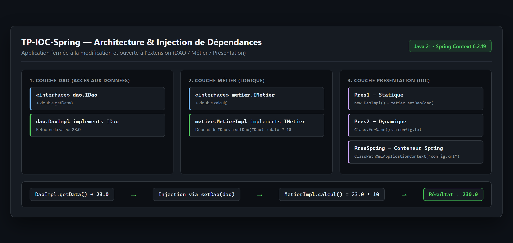
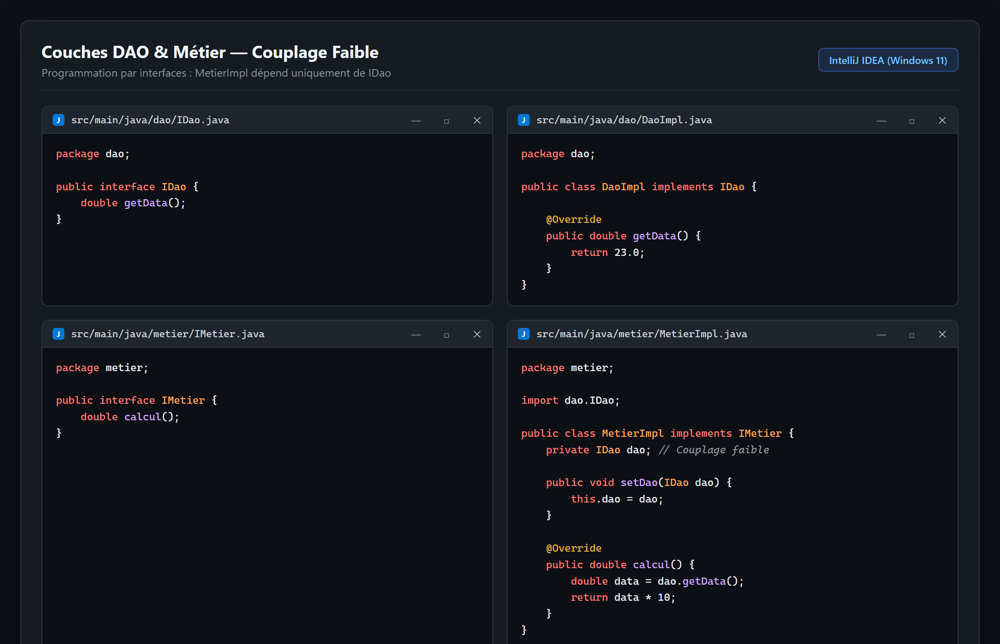
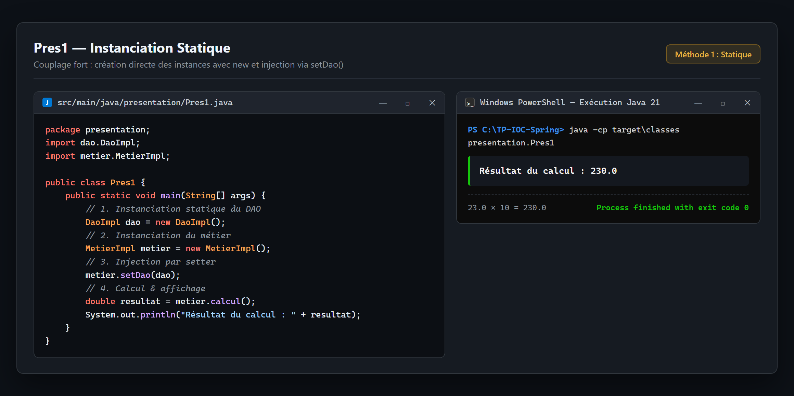
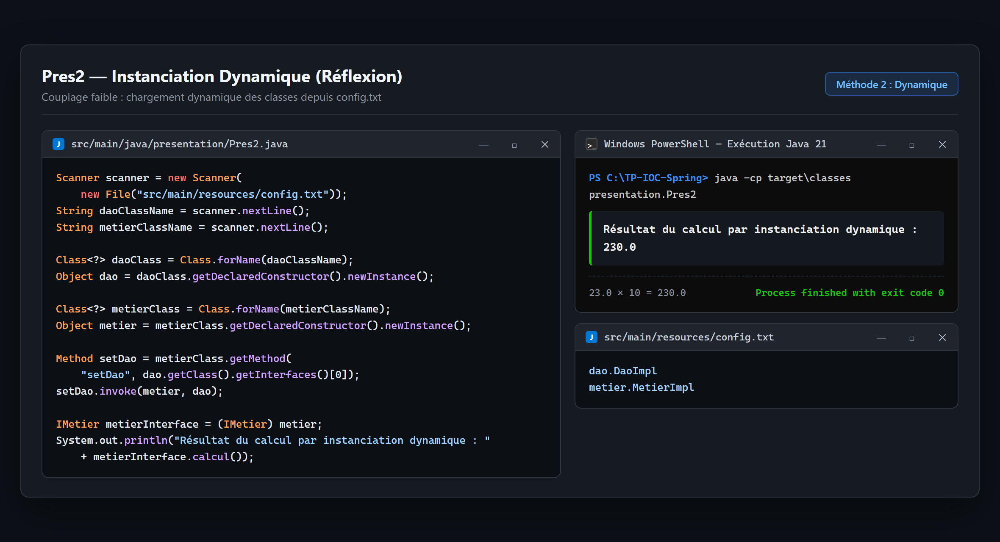
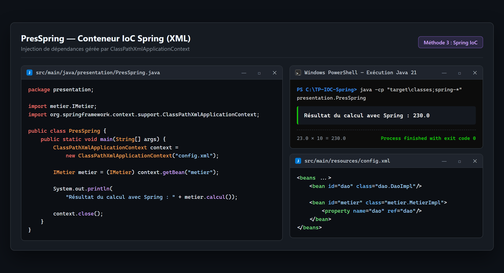

<div align="center">

# TP-IOC-Spring — Inversion de Contrôle & Injection de Dépendances

[](https://adoptium.net/)
[](https://spring.io/)
[](https://maven.apache.org/)
[]()

**Sujet :** Application Java **fermée à la modification et ouverte à l'extension** — Couplage faible & Injection des dépendances (Statique, Dynamique par réflexion, Spring XML).

</div>

---

## 📑 Sommaire

1. [Objectif](#-1-objectif)
2. [Architecture du projet](#-2-architecture-du-projet)
3. [Structure des fichiers](#-3-structure-des-fichiers)
4. [Réalisation étape par étape](#-4-réalisation-étape-par-étape)
   - [Couches DAO & Métier (`IDao`, `DaoImpl`, `IMetier`, `MetierImpl`)](#couches-dao--métier)
   - [a) Injection par instanciation statique (`Pres1`)](#a-par-instanciation-statique-pres1)
   - [b) Injection par instanciation dynamique (`Pres2`)](#b-par-instanciation-dynamique-pres2)
   - [c) Injection avec Spring IoC XML (`PresSpring`)](#c-avec-le-framework-spring-xml-presspring)
5. [Tableau récapitulatif](#-5-tableau-récapitulatif)
6. [Prérequis & Exécution](#-6-prérequis--exécution)
7. [Conclusion](#-7-conclusion)

---

## 🎯 1. Objectif

Montrer comment concevoir une application Java **fermée à la modification** et **ouverte à l'extension**, facilitant la maintenance et l'évolution :

1. **Le couplage faible** : dépendre des *interfaces* (`IDao`, `IMetier`) et non des implémentations concrètes.
2. **L'injection des dépendances** : un objet reçoit ses dépendances de l'extérieur (via `setDao(...)`) au lieu de les instancier lui-même avec `new`.

Avec l'**Inversion de Contrôle (IoC)**, le développeur se concentre sur la logique **métier**, tandis que le framework (**Spring**) gère la création des objets et le câblage technique.

---

## 🏗️ 2. Architecture du projet



---

## 📂 3. Structure des fichiers

```text
TP-IOC-Spring/
├── pom.xml                                  # Maven (Java 21, spring-context 6.2.19)
├── screenshots/                             # Captures Windows (architecture, code & console)
│   ├── 01-architecture-ioc.png
│   ├── 02-couches-dao-metier.png
│   ├── 03-pres1-statique.png
│   ├── 04-pres2-dynamique.png
│   └── 05-pres3-spring-xml.png
└── src/main/
    ├── java/
    │   ├── dao/
    │   │   ├── IDao.java                    # Interface d'accès aux données (getData)
    │   │   └── DaoImpl.java                 # Implémentation retournant 23.0
    │   ├── metier/
    │   │   ├── IMetier.java                 # Interface métier (calcul)
    │   │   └── MetierImpl.java              # Calcul métier (data * 10) avec setDao(IDao)
    │   ├── presentation/
    │   │   ├── Pres1.java                   # Instanciation statique (new)
    │   │   ├── Pres2.java                   # Instanciation dynamique (réflexion + config.txt)
    │   │   └── PresSpring.java              # Conteneur IoC Spring (config.xml)
    │   └── org/example/
    │       └── Main.java                    # Point d'entrée modèle
    └── resources/
        ├── config.txt                       # Configuration des classes pour Pres2
        └── config.xml                       # Configuration des beans Spring pour PresSpring
```

---

## 🛠️ 4. Réalisation étape par étape

### Couches DAO & Métier

- **`IDao` / `DaoImpl`** : définit le contrat `getData()` et retourne la valeur `23.0`.
- **`IMetier` / `MetierImpl`** : déclare un attribut privé de type interface `IDao` (non initialisé afin d'éviter le couplage fort), injecté via `setDao(IDao dao)`. La méthode `calcul()` retourne `dao.getData() * 10` soit **`230.0`**.



---

### a) Par instanciation statique (`Pres1`)

Dans `Pres1.java`, les objets `DaoImpl` et `MetierImpl` sont instanciés directement avec `new`, puis liés via `metier.setDao(dao)`.

- **Couches DAO & Métier** : fermées à la modification et ouvertes à l'extension.
- **Couche Présentation** : **encore ouverte à la modification** (changer d'implémentation impose de modifier le code Java et recompiler).



---

### b) Par instanciation dynamique (`Pres2`)

Dans `Pres2.java`, les noms complets des classes sont lus depuis `src/main/resources/config.txt`, instanciés dynamiquement avec `Class.forName(...).getDeclaredConstructor().newInstance()`, et reliés par réflexion (`getMethod("setDao", ...).invoke(...)`).

- La couche présentation devient **fermée à la modification et ouverte à l'extension** : il suffit de modifier `config.txt` sans toucher au code Java.



---

### c) Avec le framework Spring XML (`PresSpring`)

Dans `PresSpring.java`, le conteneur Spring (`ClassPathXmlApplicationContext("config.xml")`) lit la déclaration des beans (`dao` et `metier`), les instancie et injecte automatiquement la dépendance `dao` via `<property name="dao" ref="dao"/>`.



---

## 📊 5. Tableau récapitulatif

| Technique | Qui crée les objets ? | Changer d'implémentation DAO | Couche présentation fermée à la modification ? |
| :--- | :--- | :--- | :--- |
| **Instanciation statique (`Pres1`)** | Le développeur (`new`) | Modifier le code Java et recompiler | Non |
| **Instanciation dynamique (`Pres2`)** | Le développeur (réflexion) | Modifier `src/main/resources/config.txt` | Oui |
| **Spring XML (`PresSpring`)** | Le conteneur Spring | Modifier `src/main/resources/config.xml` | Oui |

---

## ⚙️ 6. Prérequis & Exécution

- **JDK 21** (`java -version`)
- **Apache Maven 3.9+** ou **IntelliJ IDEA (Windows)**

```powershell
git clone https://github.com/laqsour/TP-IOC-Spring.git
cd TP-IOC-Spring
mvn compile
```

Exécutez ensuite au choix `presentation.Pres1`, `presentation.Pres2` ou `presentation.PresSpring` depuis IntelliJ IDEA (bouton ▶) ou en ligne de commande.

---

## 🏁 7. Conclusion

Pour concevoir une application **fermée à la modification et ouverte à l'extension**, il faut combiner le **couplage faible** (dépendre uniquement d'interfaces) et l'**injection des dépendances**. Avec Spring IoC, la création et le câblage des objets sont délégués au conteneur, permettant au développeur de se concentrer sur le code métier.
